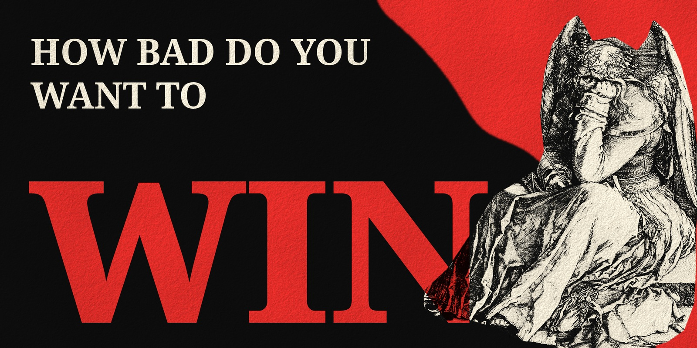

  

**[Habit](https://habit.glass/)**: software for smart glasses that sees and logs your meals, supplements and workouts with no photos or typing, and coaches you out loud.

**[RiceCraft](https://github.com/sisiphamus/ricecraft)**: the Rice Spring Hack site built as a Minecraft style block world. [Play it](https://sisiphamus.github.io/ricecraft/).

**[DroneBench](https://github.com/sisiphamus/dronebench)**: a test bench for AI agents that design small drones. Every design is flown in a simulator before it scores.

**[Babel](https://github.com/sisiphamus/babel)**: an open source Android e-reader that reads your EPUBs and PDFs out loud with an on-device voice.

[Site](https://adam-does-stuf.pages.dev/) · [LinkedIn](https://www.linkedin.com/in/adam-the-towner/)
