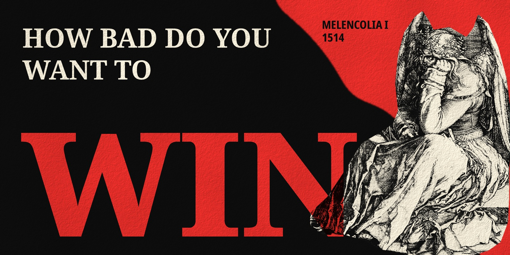

  

<table>
  <tr>
    <td width="50%" valign="top">
      <h3><a href="https://habit.glass/">Habit</a></h3>
      Software for smart glasses that sees and logs your meals, supplements and workouts with no photos or typing, and coaches you out loud.
    </td>
    <td width="50%" valign="top">
      <h3><a href="https://github.com/sisiphamus/ricecraft">RiceCraft</a></h3>
      The Rice Spring Hack site built as a Minecraft style block world. <a href="https://sisiphamus.github.io/ricecraft/">Play it</a>.
    </td>
  </tr>
  <tr>
    <td width="50%" valign="top">
      <h3><a href="https://github.com/sisiphamus/dronebench">DroneBench</a></h3>
      A test bench for AI agents that design small drones. Every design is flown in a simulator before it scores.
    </td>
    <td width="50%" valign="top">
      <h3><a href="https://github.com/sisiphamus/babel">Babel</a></h3>
      An open source Android e-reader that reads your EPUBs and PDFs out loud with an on-device voice.
    </td>
  </tr>
</table>

  <a href="https://adam-does-stuf.pages.dev/">Site</a> &nbsp;·&nbsp;
  <a href="https://www.linkedin.com/in/adam-the-towner/">LinkedIn</a>

