  

<h3 align="center">Recent public work</h3>

<table align="center">
  <tr>
    <td></td>
    <td></td>
  </tr>
  <tr>
    <td></td>
    <td></td>
  </tr>
</table>

  <a href="https://adam-does-stuf.pages.dev/">Site</a> &nbsp;·&nbsp;
  <a href="https://www.linkedin.com/in/adam-the-towner/">LinkedIn</a> &nbsp;·&nbsp;
  Rice University, Houston

